


 


 

  

<b><a href="#about">About</a></b> &nbsp;·&nbsp;
<b><a href="#experience">Experience</a></b> &nbsp;·&nbsp;
<b><a href="#stack">Stack</a></b> &nbsp;·&nbsp;
<b><a href="#projects">Projects</a></b> &nbsp;·&nbsp;
<b><a href="#cp">Competitive</a></b> &nbsp;·&nbsp;
<b><a href="#achievements">Achievements</a></b> &nbsp;·&nbsp;
<b><a href="#stats">Activity</a></b> &nbsp;·&nbsp;
<b><a href="#contact">Contact</a></b>

 


  



  

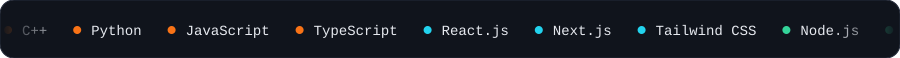

  

<table>
<tr>
<td width="50%" valign="top">
<a href="https://iclsb.just.edu.bd/"></a>

</td>
<td width="50%" valign="top">
<a href="https://auto-cp.vercel.app/"></a>

</td>
</tr>
<tr>
<td width="50%" valign="top">
<a href="https://petnest-frontend.onrender.com/"></a>

</td>
<td width="50%" valign="top">
<a href="https://auto-card.onrender.com"></a>

</td>
</tr>
</table>

<a href="https://www.tarinprosadghosh.me/projects"><b>See all projects at tarinprosadghosh.me/projects →</b></a>

 



 


  

 

Built with hand-written SVG · no JavaScript

